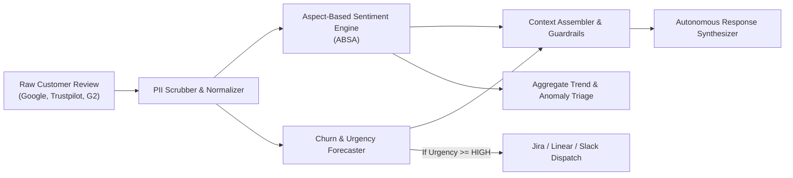

# ⚡ Revio Pulse AI: Autonomous CX & Reputation Intelligence Engine
### AI/ML Engineer Intern Assessment Deliverable for Cynbit Technologies (`cynbit.in`)


-success.svg)

---

## 📌 Executive Overview

This repository contains the complete assessment submission for the **AI/ML Engineer Intern** position at **Cynbit Technologies Private Limited** (Jaipur, Rajasthan, India).

After conducting an in-depth analysis of Cynbit’s service offerings, digital architecture capabilities, and proprietary product suite (**Revio**, **TenantEase**, and **BitElevate / Cynbit Studio**), this project presents:

1. **Strategic AI Opportunity Report:** Comprehensive analysis identifying four high-value AI opportunities across Cynbit's portfolio, with a prioritized commercial deep dive on **Revio Pulse AI**.
2. **Functional AI/ML Proof of Concept (PoC):** Fully working production prototype featuring:
   * **Aspect-Based Sentiment Analysis (ABSA):** Multi-dimensional sentiment extraction (Billing, Reliability, Support, UI/UX, Integrations).
   * **Urgency & Churn Risk Forecaster:** Calibrated risk scoring (0-100) and SLA enforcement (< 1 hour for P0 risks).
   * **Context-Aware Autonomous Response Synthesizer:** Tone-calibrated, brand-safe customer response generator with anti-hallucination guardrails.
   * **Automated Ticket Dispatcher:** Generates structured Jira / Linear / Slack webhook payloads for critical escalations.
   * **Aggregate Trend & Anomaly Triage:** Multi-tenant Net Promoter Score (NPS) and root-cause spike detector.
3. **Technical Approach Report:** In-depth blueprint covering system architecture, model choices & trade-offs, streaming data pipelines, prompt engineering guardrails, and a 12-month execution roadmap.

---

## 📁 Repository Structure

```
cynbit-ai-opportunity/
├── AI_OPPORTUNITY_REPORT.md       # Deliverable 1: Market analysis, unit economics & opportunity audit
├── TECHNICAL_APPROACH_REPORT.md  # Deliverable 3: Architecture, model trade-offs & execution roadmap
├── SUBMISSION_SUMMARY.md         # Form links, execution notes & campaign rationale for portal
├── README.md                     # Project overview and setup instructions
├── requirements.txt              # Production and development dependencies
│
├── engine/                       # Core AI/ML Modular Engine
│   ├── __init__.py
│   ├── sentiment_absa.py         # Aspect-Based Sentiment Analysis (ABSA)
│   ├── urgency_churn.py          # Churn risk scoring & SLA triage
│   ├── response_generator.py     # Context-aware de-escalation response synthesis
│   ├── trend_detector.py         # Trend analytics & anomaly detection
│   └── jira_dispatch.py          # Jira / Linear / Slack webhook dispatcher
│
├── data/
│   └── sample_reviews.csv        # Multi-platform dataset (Google, Trustpilot, G2, App Store)
│
├── run_demo.py                   # Zero-dependency end-to-end CLI demonstration
├── test_suite.py                 # Comprehensive unit test suite
├── app.py                        # Interactive Streamlit dashboard UI
├── api.py                        # Production FastAPI REST microservice
└── Revio_AI_Opportunity_PoC.ipynb # Google Colab-ready interactive notebook
```

---

## 🚀 Quickstart Guide

### 1. Clone & Install Dependencies
```bash
git clone https://github.com/ArnavP2305/cynbit-ai-opportunity.git
cd cynbit-ai-opportunity
pip install -r requirements.txt
```

### 2. Run the Zero-Dependency CLI Demonstration
To verify the full pipeline and review diagnostic reports directly in your terminal:
```bash
python run_demo.py
```

### 3. Run the Automated Unit Test Suite
```bash
python test_suite.py
```
*(All 5 tests covering ABSA, Churn Triage, Guardrails, and Ticket Generation pass in < 0.01s)*

### 4. Launch the Interactive Streamlit Dashboard
```bash
streamlit run app.py
```
*Access the UI at `http://localhost:8501` to test sample scenarios, adjust brand voice, inspect aspect breakdowns, and review auto-generated Jira tickets.*

### 5. Launch the REST API
```bash
python api.py
```
*Access interactive Swagger API documentation at `http://localhost:8000/docs`.*

---

## 🏗️ Architecture Blueprint



---

## 📊 Core Business & Revenue Impact for Cynbit

* **New SaaS Tier ("Revio Pulse Enterprise"):** Positions Revio to monetize an enterprise tier at **\$199–\$499/month**, expanding Cynbit's SaaS ARR.
* **87% CX Labor Reduction:** Automates review triaging and first-draft generation, saving an estimated 15+ hours weekly per client account.
* **Customer Churn Prevention:** Sub-1-hour escalation response for critical P0 complaints preserves customer lifetime value (LTV).

---

## 📑 Assessment Deliverables Quick Links

* 📄 [AI Opportunity Report](AI_OPPORTUNITY_REPORT.md)
* ⚙️ [Technical Approach Report](TECHNICAL_APPROACH_REPORT.md)
* 📋 [Portal Submission Summary & Execution Notes](SUBMISSION_SUMMARY.md)
* 📓 [Google Colab Notebook](Revio_AI_Opportunity_PoC.ipynb)

---
*Built with precision for Cynbit Technologies Private Limited | November 2026*
